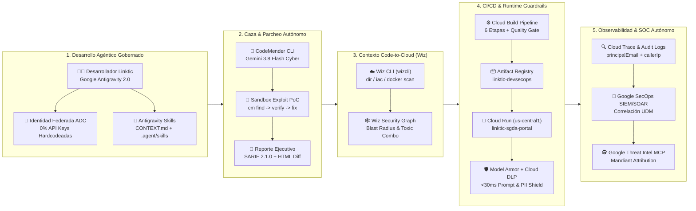

# 🛡️ Linktic End-to-End Agentic DevSecOps Pipeline Demo
### Sistema Inteligente de Radicación, Auditoría Documental y Triaje con IA (SGDA & Claims AI Portal)

[](https://ssh.cloud.google.com/cloudshell/editor?cloudshell_git_repo=https://github.com/jmaciasc-google/linktic-devsecops-demo&cloudshell_tutorial=tutorial.md&cloudshell_project=jmaciasc)

> **🚀 Lanzamiento Rápido del Tutorial Interactivo en Cloud Shell:**
> Si ya estás dentro de Google Cloud Shell o Cloud Shell Editor, ejecuta este comando de 1 línea para abrir el panel interactivo paso a paso a la derecha de tu pantalla:
> ```bash
> cloudshell launch-tutorial tutorial.md
> ```

---

## 🎯 Resumen Ejecutivo para Linktic

Esta demostración presenta una arquitectura **End-to-End Agentic DevSecOps** funcional y desplegada en vivo en **Google Cloud (`jmaciasc` / `599979914124`)**, diseñada específicamente para las verticales estratégicas de **Linktic**:
- **Gobierno Digital & SGDA/PQRS:** Radicación documental y respuesta ciudadana automatizada con trazabilidad forense.
- **Salud, Telemedicina & ARL (ej. Positiva):** Auditoría clínica e inspección de soportes médicos con protección estricta de Historias Clínicas y PII.
- **Fiduciaria & Banca:** Validación de desembolsos fiduciarios de alto valor y control de acceso de mínimo privilegio.

El proyecto demuestra cómo **Google Cloud Security + Wiz + Antigravity + CodeMender** eliminan la fricción histórica entre la **Fábrica de Software (Velocidad)** y **Ciberseguridad / Red Team / SOC (Control)** mediante:
1. **0% API Keys en Código:** Autenticación 100% basada en identidad federada y **Application Default Credentials (ADC)** hacia Vertex AI, eliminando de raíz incidentes de llaves filtradas en repositorios o contenedores.
2. **0% Falsos Positivos con Verificación Empírica en Sandbox (CodeMender):** El agente autónomo **CodeMender** (impulsado por **Gemini 3.8 Flash Cyber**) no solo detecta vulnerabilidades complejas (`SQLi CWE-89`, `OS Command Injection CWE-78`, `SSRF CWE-918`), sino que compila y ejecuta un **Exploit PoC real en un sandbox aislado** antes de reportar el hallazgo y generar el parche (`git diff`) verificado.
3. **Priorización Code-to-Cloud y Blast Radius (Wiz Security Graph):** Integración nativa con **Wiz CLI (`wizcli`)** y el skill de Antigravity **`code-to-cloud-triage`** para correlacionar una línea vulnerable en `backend/app.py` con la exposición real del servicio en **Cloud Run**, los permisos IAM del Service Account (`linktic-sgda-runner`) y el **camino de ataque (Toxic Combination)** hacia **Secret Manager** y datos ciudadanos.
4. **Defensa Inline en Tiempo Real (`<30ms`) con Model Armor & Cloud DLP:** Firewall semántico en línea que bloquea **Prompt Injection (Directo e Indirecto)** y enmascara automáticamente datos sensibles colombianos (**Cédula de Ciudadanía**, tarjetas de crédito y credenciales) antes de tocar el modelo fundacional en Vertex AI.
5. **Observabilidad Forense de Identidad a Código (Cloud Trace + Google SecOps + GTI MCP):** Correlación en tiempo real de cada petición (`traceId`, `spanId`, `principalEmail`, `callerIp`, veredicto de Model Armor) con reglas UDM en **Google SecOps (Chronicle SIEM/SOAR)** y enriquecimiento de actores de amenaza vía **Google Threat Intelligence (Mandiant GTI) MCP**.

---

## 🏗️ Arquitectura End-to-End (Shift-Left a Shift-Right)



---

## 🧰 Matriz de Productos Google Cloud + Wiz Incluidos

| Producto / Tecnología | Rol en el Pipeline DevSecOps de Linktic | Etapa / Acto | Artefacto / Evidencia en este Repo |
| :--- | :--- | :--- | :--- |
| **Google Antigravity 2.0** | IDE Agéntico con gobierno centralizado, reglas de seguridad y ejecución de Skills especializados. | Acto 1 & 3 | `.agent/skills/`, `CONTEXT.md` |
| **Gemini Enterprise Standard (Vertex AI ADC)** | Motor de IA para triaje clínico/fiduciario autenticado vía **Application Default Credentials (0% API Keys)**. | Acto 1 & 4 | `backend/app.py` (`/api/ai/triage`) |
| **CodeMender (`cm` CLI)** | Agente autónomo de vulnerabilidades que ejecuta `cm find`, valida con exploit PoC en sandbox (`cm verify`) y genera el parche (`cm fix`). | Acto 2 | `.codemender/config.yaml`, `artifacts/codemender_report.html` |
| **Gemini 3.8 Flash Cyber** | Modelo especializado en razonamiento de código seguro, análisis de flujo de datos inter-procedimental y generación de exploits/parches. | Acto 2 | `artifacts/results.sarif`, `scripts/demo_cli_runner.sh` |
| **Wiz CLI (`wizcli`) & Wiz Security Graph** | Escaneo de secretos, Terraform IaC y contenedores + correlación de **Toxic Combinations** y **Blast Radius** en Cloud. | Acto 3 | `artifacts/wizcli_scan_report.json`, `.agent/skills/code-to-cloud-triage/SKILL.md` |
| **Cloud Build** | Pipeline CI/CD serverless de 6 pasos con compuertas obligatorias (Quality Gates) de Pytest, Wiz y CodeMender SARIF. | Acto 4 | `cloudbuild.yaml` |
| **Artifact Registry** | Repositorio privado de contenedores en `us-central1` con análisis de vulnerabilidades de imágenes Docker. | Acto 4 | `us-central1-docker.pkg.dev/jmaciasc/linktic-devsecops` |
| **Cloud Run** | Plataforma serverless en `us-central1` ejecutando contenedor no-root (`UID 10001`) con Service Account de mínimo privilegio. | Acto 4 | `Dockerfile`, `terraform/main.tf` |
| **Model Armor** | Firewall semántico inline (`<30ms`) contra Direct/Indirect Prompt Injection y Jailbreaks en aplicaciones GenAI. | Acto 4 | `backend/security_modes.py`, `POST /api/ai/triage` |
| **Cloud DLP (Sensitive Data Protection)** | Detección y enmascaramiento en línea de **Cédulas de Ciudadanía Colombianas**, tarjetas financieras y secretos. | Acto 4 | `backend/security_modes.py`, `tests/test_app_and_security.py` |
| **Cloud Trace & Cloud Audit Logs** | Trazabilidad distribuida e identidad forense (`traceId`, `principalEmail`, `callerIp`) desde el navegador hasta la consulta SQL/LLM. | Acto 5 | `GET /api/telemetry/logs` |
| **Google SecOps & Mandiant GTI MCP** | Correlación SIEM/SOAR en formato UDM e investigación agéntica vía servidores MCP (`gti-mcp-server`, `secops-mcp`). | Acto 5 | `GET /api/telemetry/logs`, `DEMO_GUIDE_LINKTIC.md` |

---

## ⚡ Comandos Rápidos (`Makefile`)

Ejecuta cualquiera de estos objetivos desde la raíz del repositorio:

```bash
# 1. Ejecutar el Verificador Pre-Flight Automatizado de 10 Puntos (10/10 Checks)
make verify

# 2. Ejecutar la suite completa de pruebas funcionales y de seguridad (Pytest)
make test

# 3. Levantar el portal web interactivo localmente en http://localhost:8080
make run-local

# 4. Ejecutar el ciclo completo de CodeMender (find -> verify -> fix -> report)
make cm-scan

# 5. Ejecutar el escaneo Code-to-Cloud con Wiz CLI + Antigravity Triage Skill
make wiz-scan

# 6. Desplegar el servicio en vivo en Google Cloud Run (Proyecto Argolis: jmaciasc)
make deploy-argolis

# 7. Disparar el pipeline CI/CD de 6 pasos en Google Cloud Build
make cloudbuild

# 8. Abrir el tutorial interactivo nativo en Google Cloud Shell
make tutorial
```

---

## 📂 Estructura del Proyecto

```text
linktic-devsecops-demo/
├── README.md                          # Documentación ejecutiva y botón Open in Cloud Shell
├── tutorial.md                        # Tutorial interactivo nativo de Google Cloud Shell
├── Linktic_DevSecOps_Live_Demo.ipynb  # Jupyter Notebook ejecutable en vivo (12 celdas)
├── DEMO_GUIDE_LINKTIC.md              # Runbook del presentador, guion de 5 actos y Q&A por rol
├── Makefile                           # Atajos de automatización (verify, test, deploy-argolis, etc.)
├── CONTEXT.md                         # Invariantes de arquitectura y seguridad para CodeMender y Antigravity
├── Dockerfile                         # Contenedor endurecido (Python 3.11-slim, usuario no-root appuser)
├── cloudbuild.yaml                    # Pipeline CI/CD de 6 etapas en Google Cloud Build
├── requirements.txt                   # Dependencias de FastAPI, Uvicorn, Pydantic, HTTPX y Pytest
├── .codemender/
│   └── config.yaml                    # Configuración de CodeMender CLI para Vertex AI
├── .agent/skills/
│   ├── evaluate-codemender-finding/   # Skill de Antigravity para orquestar cm verify & cm fix
│   └── code-to-cloud-triage/          # Skill de Antigravity para correlación CodeMender + Wiz Graph
├── backend/
│   ├── app.py                         # API FastAPI (modos v1-vulnerable y v2-secure en caliente)
│   ├── security_modes.py              # Guardrails de SQLi/CmdInj/SSRF + Model Armor + Cloud DLP
│   └── seed_data.py                   # Base SQLite sintética de radicados SGDA, ARL y Fiduciaria
├── frontend/
│   └── index.html                     # SPA ejecutiva con switch v1/v2 en vivo y 5 pestañas interactivas
├── artifacts/
│   ├── codemender_report.html         # Reporte ejecutivo HTML de CodeMender con diffs y PoCs
│   ├── results.sarif                  # Hallazgos verificados en formato estándar SARIF 2.1.0
│   └── wizcli_scan_report.json        # Resultados de wizcli (IaC, secretos, contenedor y Blast Radius)
├── terraform/
│   ├── main.tf                        # IaC remediado (SA mínimo privilegio, Secret Manager, Cloud Armor)
│   └── main_vulnerable.tf.example     # IaC vulnerable pre-remediación (API key expuesta, roles/editor)
├── scripts/
│   ├── verify_demo_readiness.py       # Verificador automatizado Pre-Flight de 10 puntos
│   ├── demo_cli_runner.sh             # Wrapper inteligente para CodeMender CLI y Wiz CLI
│   └── setup_argolis.sh               # Script de aprovisionamiento y despliegue en Argolis (jmaciasc)
└── tests/
    └── test_app_and_security.py       # Suite Pytest validando explotación en v1 y bloqueo 100% en v2
```

---

## 🧭 Tres Modalidades de Demostración en Vivo

1. **🖥️ Interfaz Web Ejecutiva (SPA en Cloud Run):**
   Navega por las 5 pestañas interactivas del **Portal SGDA & Claims AI de Linktic**, alternando en un clic entre **`🔴 MODO v1-VULNERABLE`** y **`🟢 MODO v2-SECURE`** para demostrar la explotación en vivo y la remediación inmediata.
2. **🐚 Tutorial Guiado en Google Cloud Shell (`tutorial.md`):**
   Haz clic en el botón **Open in Cloud Shell** de arriba o ejecuta `cloudshell launch-tutorial tutorial.md` para seguir el recorrido guiado de 5 actos con botones **"Run in Terminal"** integrados y notas de orador para cada líder de Linktic.
3. **📓 Jupyter Notebook Interactivo (`Linktic_DevSecOps_Live_Demo.ipynb`):**
   Ábrelo en **Cloud Shell Editor**, **Google Antigravity** o **Vertex AI Workbench** y ejecuta cada una de las 12 celdas con `▶ Run` para inspeccionar peticiones HTTP, escaneos de `CodeMender`, correlación de `Wiz CLI`, bloqueos de `Model Armor` y trazas forenses de `Google SecOps`.
